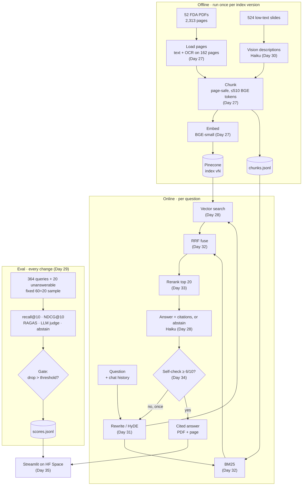

# Multimodal RAG Engine

Ask questions over 52 FDA PDFs (slide decks + 2 books). The system retrieves pages, answers with verified citations, abstains when the answer is not in the documents, and is scored by an eval pipeline that gates every change.

Dataset: ViDoRe V3 Pharmaceuticals (`vidore/vidore_v3_pharmaceuticals`, CC BY 4.0), 2,313 pages, 364 English queries with graded page labels, plus 20 hand-written unanswerable queries.

## Architecture



### Modules

Package `multimodal_rag/`.

| File | Does | Day |
|---|---|---|
| `config.py` | Constants: paths, model IDs, index name, thresholds, prices, flags | 27 (grows) |
| `contracts.py` | The stage-contract dataclasses below (kept out of `ingest.py` so the query path never imports `unstructured`) | 28 |
| `ingest.py` | PDFs → `Page` → `Chunk`; writes `chunks.jsonl`; embeds and upserts | 27, 30 |
| `retrieve.py` | Vector search, BM25, RRF, rerank, rewrite/HyDE | 28, 31–33 |
| `answer.py` | Haiku call with citations, citation verification, abstain, cost, self-check | 28, 34 |
| `vision.py` | Slide image → Haiku description | 30 |
| `evaluate.py` | Retrieval metrics, RAGAS, LLM judge, abstain score, gate, score log, follow-up tests | 28–29, 31 |
| `streamlit_app.py` (repo root) | One-page UI | 35 |

### Data files

| File | Contents | Day |
|---|---|---|
| `data/chunks.jsonl` | All chunks (BM25 + UI display), ~4 MB | 27 |
| `data/eval/unanswerable_en.jsonl` | 20 unanswerable queries | 27 |
| `data/eval/sample.json` | IDs of the fixed 60 + 20 eval sample | 28 |
| `data/eval/followups.jsonl` | 10 two-turn conversations | 31 |
| `data/vision.jsonl` | 524 slide descriptions | 30 |
| `data/scores.jsonl` | Timestamped eval log | 29 |

### Stage contracts

Frozen dataclasses passed between stages:

| Type | Fields | Made by → used by |
|---|---|---|
| `Page` | `doc_id`, `page` (0-indexed), `text`, `ocr: bool` | ingest → chunking |
| `Chunk` | `chunk_id` (`doc_id-page-n`), `doc_id`, `page`, `text`, `n_tokens`, `kind` (`text` or `vision`) | chunking → index, BM25, answer |
| `SearchQuery` | `question` (what Claude answers), `text` (what BGE embeds), `passage: bool` (HyDE), `cost_usd` | retrieve → retrieve, answer, eval |
| `Hit` | `chunk: Chunk`, `score` (cosine; RRF score under `RETRIEVAL=hybrid`; cross-encoder logit under `RERANK=1`) | retrieve → answer, eval |
| `Citation` | `chunk_id`, `doc_id`, `page`, `cited_text`, `score`, `generated: bool` | answer → UI, eval |
| `Answer` | `text`, `citations`, `abstained`, `cost_usd`, `latency_s`, `confidence`, `retried` (both added Day 34) | answer → UI, eval |

**Pinecone record:** id = `chunk_id`, 384-d vector, metadata = `doc_id`, `page`, `text`, `kind`, `embedding_model`. Index `fda-bge-small-en-v1-5-v1` (the version suffix goes up on re-index), namespace `fda`. Embedding model: `BAAI/bge-small-en-v1.5`.

**Flags** (environment variables, only the measured ablations): `REWRITE`, `HYDE`, `RETRIEVAL=vector|hybrid`, `RERANK`, `SELF_CHECK`. Vision descriptions have no flag: the index version (`INDEX_NAME`) switches them.

### Chunking rule

```
page text → slide page: 1 candidate
          → book page:  chunk_by_title(max_characters=1500) → 1–3 candidates
candidate → count BGE tokens
          → ≤ 510: keep
          → > 510: split at sentence boundaries, packing sentences up to 510
                   (a single sentence over 510 is split by words)
every final chunk ≤ 510 BGE tokens and never crosses a page
```

510 = BGE's 512-token limit minus `[CLS]` and `[SEP]`.

### Fixed facts the code relies on

- Dataset pages are 0-indexed. The loader takes the page number from its pypdf loop index (0-indexed), never from `unstructured` (1-indexed). `pdftoppm` is 1-indexed, so OCR passes `page + 1`.
- `partition_pdf(strategy="fast")` drops a whole PDF to `hi_res` with no text if any one page has heavy vector graphics (2 of 52 files, incl. the 373-page book). So each page is partitioned as its own 1-page PDF; only the heavy page falls back and gets OCR.
- OCR runs per page, only on the 162 low-text pages (~3 s/page).
- Haiku 5.5: never pass `temperature`. RAGAS uses `bypass_temperature=True` with `langchain-community<0.4`.
- Rerank at most the top 20 (~1.6 s on 2 CPUs).
- Docker uses CPU-only torch.
- The eval sample is never used for tuning.

## Retrieval and answering (Day 28)

Try one question: `python -m multimodal_rag.answer "your question"`. Retrieval baseline: `python -m multimodal_rag.evaluate` (free, ~40 s, no Claude calls).

Query → BGE vector (with the BGE query instruction) → Pinecone top 20 → chunk text from `data/chunks.jsonl` → the top 10 chunks (no score threshold since Day 30) go to Haiku as one plain-text document each, with citations on. A citation is kept only if its `cited_text` equals `chunk.text[start:end]` of the chunk it points to. Timeouts: Pinecone 10 s, Claude 30 s per attempt (the SDKs retry on their own). Pinecone timeouts, connection errors and 5xx, Claude API errors, and any `stop_reason` other than `end_turn` raise `QueryError`.

### Day 28 results (index `fda-bge-small-en-v1-5-v1`)

| Measure | Value |
|---|---|
| recall@10 (page-level, 364 queries) | **0.5575** |
| NDCG@10 (gain = qrel grade 1/2) | **0.5037** |
| Queries with > 10 gold pages (recall can't reach 1.0) | 43 |
| Eval sample (`data/eval/sample.json`, seed 28, never changed) | 60 answerable (stratified by query type × visual content; 36 visual) + 20 unanswerable |
| `ABSTAIN_SCORE` = 5th percentile of top-1 score on the 304 non-sample queries | 0.6837 |
| Sample answerable below it (false abstains) | 4/60 |
| Unanswerable below it (correct abstains with no Claude call) | 1/20 |
| Top-1 score range | answerable 0.618–0.883, unanswerable 0.671–0.816 |
| Cost per answered question (10 chunks, about 4.5k tokens in) | $0.0005–0.0013 |

The score threshold does little: unanswerable top-1 scores sit inside the answerable range, so it catches 1 of 20. In practice Claude does the abstaining: it returned `ABSTAIN_TEXT` on both unanswerable questions in the spot-check. Abstain accuracy both ways is measured on Day 29.

Hits are chunks and gold labels are pages, so the eval dedupes the 20 chunks to pages and scores the first 10 distinct pages. Measured effect: small. The top 10 chunks already cover 9.76 distinct pages on average, and scoring them directly gives recall@10 0.5540 instead of 0.5575.

### Three deliberate breaks, diagnosed with the 4-step loop

The loop: (1) is the answer in the corpus (gold pages)? (2) were those pages retrieved, and at what rank and score? (3) what actually went into the prompt? (4) given known-good chunks, does Claude answer correctly?

| Break | Symptom | Step that found it | Evidence |
|---|---|---|---|
| Queries embedded with `all-MiniLM-L6-v2` (also 384-d, a different vector space) against the BGE index | Wrong pages, no error raised | 2 | recall@10 0.5575 → 0.2312, NDCG@10 0.5037 → 0.1829; mean top-1 score 0.776 → 0.263, so every query would fall below `ABSTAIN_SCORE`. Random query vectors give recall 0.0053, so MiniLM is far above chance. My unverified guess is that the two small BERT models' spaces partly line up. |
| Each chunk cut to its first 300 characters before it goes to Claude (query 47) | "The documents do not contain the answer." | 3 | The gold page is still retrieved at rank 1, but the fact ("18 months … 10,000 individuals") sits at character 621. With full chunks (step 4), Claude answers and cites it. |
| `max_tokens=40` | `QueryError: Claude stopped with max_tokens` | 4 (`stop_reason` check) | Without the check, a cut-off sentence with partial citations would have been returned as an answer. |

### Spot-check of 10 outputs (8 non-sample answerable + 2 unanswerable, $0.0066 for the final outputs)

| Query | Result |
|---|---|
| 243 naloxone OTC consumer research | Correct, cited the gold pages |
| 327 CGMP and drug quality | Correct |
| 43 EU small-molecule data exclusivity | Answers with the current 8+2+1 rule. The reference says 6 years (Directive 87/21/EEC), which the answer mentions as the earlier rule. Defensible. |
| 228 unit-of-use packaging (yes/no) | Hedges ("documents don't confirm") where the reference says yes. The cited page isn't the gold page but carries the same slide text. |
| 28 biosimilar vs interchangeable | Correct, 2,962 characters (reference is about 300) |
| 57 decentralized trials and digital health | Correct and partial; says it's partial |
| 197 refuse-to-receive % FY15 vs FY16 | **False abstain, step 3.** Gold page retrieved at rank 3, but the bar chart extracts as loose numbers ("19 25 13 FY 15 FY 16 FY 17 8.3"), so the year-to-value pairing is lost. Claude declined to guess. Day 30 vision descriptions target this. |
| 95 injectables vs solid oral first-cycle approvals (keyword query) | **False abstain, step 2.** The gold page holds the exact phrase "Injectables > solid oral > others" but isn't in the top 10. A keyword match should find it (BM25, Day 32). |
| ua03 GDUFA III CMO fee (trap) | Claude abstained |
| ua01 Spravato REMS monitoring | Abstained by threshold, no Claude call |

Fixed during the spot-check: with `ANSWER_MAX_TOKENS = 1024`, queries 28 and 57 stopped at `max_tokens` (the `stop_reason` check raised `QueryError`). One needed 1,598 output tokens, since citations add output tokens. Raised to 2048; both then ended with `end_turn`.

Observed and not changed today (prompt changes wait for the Day 29 gate): Haiku often opens with a hedge about what the documents do or don't say, and open-ended answers run about 10× the reference length. This may lower answer relevancy on Day 29.

## Vision descriptions (Day 30)

Run: `python -m multimodal_rag.vision` (writes `data/vision.jsonl`; 3.5 min, $0.18), then `python -m multimodal_rag.ingest vision` (builds the index named in `config.py` from the committed text chunks + the descriptions; 93 s embedding on an M3, $0).

Slide pages whose chunk text totals < 300 chars (524) are rendered at 100 dpi and described by Haiku: title, every chart/table/diagram, every readable number with its label. Each description becomes `kind="vision"` chunks on its page (ids continue the page's numbering), reaches Claude titled "generated visual description, <doc> p.N", and its citations carry `generated=True`. The text chunks are byte-identical to v1, so the eval measures only the descriptions. A `stop_reason: refusal` now returns its own outcome (`refused=True`, fixed text, cost kept) and counts against both abstain scores.

### Day 30 results (Ram's M3; index v1 → `fda-bge-small-en-v1-5-v2`)

| Measure | v1 (Day 29 run 2) | v2 run 1 | v2 run 2 (accepted) | v2, no abstain threshold |
|---|---|---|---|---|
| recall@10 (364 queries) | 0.5568 | 0.5787 | 0.5787 | **0.5787** |
| NDCG@10 | 0.5034 | 0.5180 | 0.5180 | **0.5180** |
| recall@10 Chart / Infographic / Image | 0.4027 / 0.4300 / 0.4222 | 0.4374 / 0.4500 / 0.4329 | same | **0.4374 / 0.4500 / 0.4329** |
| faithfulness | 0.9254 | 0.9273 | 0.9343 | **0.9193** |
| answer relevancy | 0.8675 | 0.7869 (gate FAIL) | 0.8481 | **0.8330** |
| context precision | 0.4660 | 0.4638 | 0.4582 | **0.4584** |
| context recall | 0.5264 | 0.5831 | 0.5632 | **0.5486** |
| judge faithfulness / relevance / completeness | 3.45 / 3.15 / 2.68 | 3.70 / 3.23 / 2.87 | 3.72 / 3.37 / 2.87 | **3.62 / 3.37 / 2.87** |
| unanswerable abstained | 20/20 | 20/20 | 20/20 | **20/20** |
| answerable answered | 45/60 | 47/60 | 48/60 | **49/60** |
| refused | – | 0 | 0 | **0** |
| run cost | $0.494 | $0.514 | $0.521 | $0.525 |

| Measure | Value |
|---|---|
| Pages described | 524 of 524 (0 refusals, 0 cut off) |
| Vision chunks / index size | 542 (17 descriptions split at 510 tokens) / 4,725 vectors |
| Description length | median 426 chars, max 1,360 BGE tokens |
| Image cost | 1000×750 px ≈ 970 visual tokens per slide; 100 dpi read every value as well as 150 dpi on 3 measured slides |
| Description cost | $0.1819 total |

v2 run 1 failed the gate on answer relevancy alone. A sandbox run of the same code scored 0.840, and answers citing generated descriptions scored the same as the others (0.838 vs 0.841); the zeros come from hedged openings that RAGAS marks noncommittal. v2 was accepted by a rule fixed before the rerun: the mean of two v2 runs within 0.05 of the mean of two v1 runs (0.850), i.e. run 2 ≥ 0.813.

`ABSTAIN_SCORE` removed by the Day 29 rule: on v2 it caught 1/20 unanswerable (ua01, which Claude also abstains on) and blocked 2 answerable queries with the gold page in the top 10 (218 rank 3, 334 ranks 2 and 4). Measured as its own run: answered 48 → 49/60, unanswerable 20/20, gate PASS. Index v1 deleted after acceptance.

Open: answer relevancy moved 0.868 → 0.848 → 0.833 across two passed runs; each run is compared only to the last passed one, and its 0.05 threshold is narrower than the observed spread (0.787–0.868).

## Query rewriting and HyDE (Day 31)

Run: `python -m multimodal_rag.evaluate` (free eval) with `REWRITE=1` or `HYDE=1` set; `python -m multimodal_rag.evaluate followups` (the 10 two-turn conversations).

`search_query` decides what is embedded for a question. A follow-up (non-empty chat history = earlier user questions) is always rewritten by Haiku into a standalone question, which is searched and answered. `REWRITE=1` rewrites every question for search only; Claude still answers the user's words. `HYDE=1` has Haiku write a ~100-word FDA-style passage answering the question and embeds it on BGE's passage side (no query prefix), like the indexed chunks. The rewrite / HyDE cost is added to `Answer.cost_usd`.

The rewriter is a forced tool call (`record_query`, one `query` field): the query arrives as JSON, so commentary cannot leak into it, and a forced `tool_choice` turns thinking off. Its prompt allows only resolving references with words copied from the earlier questions, and says to return a standalone question unchanged.

### Day 31 results (sandbox, index v2; free retrieval metrics, page-level @10)

| Queries | off | `REWRITE=1` (first prompt) | `REWRITE=1` (final prompt) | `HYDE=1` |
|---|---|---|---|---|
| all 364: recall / NDCG | 0.5787 / 0.5180 | 0.5832 / 0.5219 | 0.5787 / 0.5180 | 0.5835 / 0.5204 |
| **304 non-sample (decides the flags)**: recall / NDCG | **0.5952 / 0.5298** | 0.5971 / 0.5283 | 0.5952 / 0.5298 | 0.5930 / 0.5240 |
| 57 keyword: recall / NDCG | 0.5235 / 0.4828 | 0.4941 / 0.4641 | 0.5235 / 0.4828 | 0.5548 / 0.4988 |
| 47 keyword non-sample: recall / NDCG | 0.5255 / 0.4682 | 0.4877 / 0.4440 | 0.5255 / 0.4682 | 0.5562 / 0.4909 |
| recall Chart / Infographic / Image | 0.4374 / 0.4500 / 0.4329 | 0.4427 / 0.4346 / 0.4193 | 0.4374 / 0.4500 / 0.4329 | 0.4528 / 0.4922 / 0.4168 |
| Claude cost, 364 queries | $0 | $0.013 | $0.039 | $0.120 |
| eval wall time (8 parallel calls) | 41 s | 82 s | – | 217 s |

Ram's Mac, flags off: 0.5787 / 0.5180 (all 364), identical to the sandbox.

Follow-ups (10 conversations in `data/eval/followups.jsonl`; turn 2 is a non-sample dataset query reworded to depend on turn 1, gold pages inherited from that query). Rewrites vary from run to run, so each prompt was run several times:

| Follow-up searched as | recall@10 per run | NDCG@10 per run | rewrites with facts from outside the conversation |
|---|---|---|---|
| raw follow-up | 0.483 | 0.429 | – |
| rewritten, first prompt (4 sandbox runs + 1 Mac run) | 0.578, 0.578, 0.528, 0.458; Mac 0.578 | 0.413, 0.400, 0.402, 0.330; Mac 0.432 | in most runs (below) |
| rewritten, final prompt (2 sandbox runs + 1 Mac run) | 0.533, 0.483; Mac 0.558 | 0.395, 0.347; Mac 0.409 | 0 of 30 |
| original dataset query (ceiling) | 0.570 | 0.464 | – |

Rewrite cost for the 10: $0.0006–0.0011 per run.

Findings:
- Neither flag beats "off" on the 304 non-sample queries, so both stay off and no full eval ran.
- First rewrite prompt: on the 57 "keyword" queries, which are already descriptive phrases ("prescription drugs included vs excluded under DSCSA"), 51 rewrites left recall unchanged and 4 lost pages through small wording changes. For example, query 224 lost its only gold page (recall 1.00 → 0) when "as it relates to" became "in".
- First prompt on the follow-ups: the rewriter added facts it knew, against the prompt. Examples: c02 "four-letter suffix" (part of the answer); c04 "Federal Food, Drug, and Cosmetic Act section 301(ll)", "adulterated", "cannabidiol"; c10 "generic drug applications". Because a follow-up's rewrite is the question Claude answers, a leaked fact steers the answer.
- First tightened prompt, still free text: one reply carried the model's own reasoning ("Wait—the rules say…") into the query. Hence the forced tool call.
- Final prompt: no outside facts and no commentary in 30 rewrites (one Mac rewrite merged two copied words: "pharmaceuticalmanufacturing"). On standalone questions `REWRITE=1` now returns the question unchanged (identical metrics on all 364) at $0.039 per 364 queries, so the flag has no use on this dataset. Follow-up recall: 0.483 raw → 0.483–0.558 rewritten, against 0.458–0.578 for the first prompt. With 10 conversations and this run-to-run spread, the two prompts cannot be told apart on recall; the final prompt was chosen for what Claude is asked, not for recall.
- c09 scores 0 under every rewrite and 0.2 at best, although the final rewrite names CDER and the COVID-19 response. It is a retrieval miss, not a rewrite problem.
- HyDE raised recall on 16 keyword queries and lowered it on 4 (per-query diagnostic, $0.018). It helps when the slide's wording differs from the query's: query 95's gold page went from rank > 10 to found. It hurts when the generated passage is generic or has specifics of its own; query 163 lost its gold page.
- HyDE makes retrieval nondeterministic: keyword recall was 0.5548 and 0.5555 in two runs. The flags-off retrieval metrics are deterministic.
- HyDE on the 20 unanswerable queries: 20/20 still abstain (off: 20/20), 0 refusals, $0.019. Mean top-1 retrieval score rises 0.769 → 0.824: a passage matches passages more closely than a question does, so similarity scores are not comparable with and without HyDE.

## Hybrid retrieval (Day 32)

Run: `python -m multimodal_rag.evaluate` (free, ~50 s). Hybrid is the default since Ram's Mac run passed the gate (2026-10-12); `RETRIEVAL=vector` is the Day 30 path, unchanged.

`Retriever` builds a BM25 index (`rank-bm25` `BM25Okapi`, k1 = 1.5, b = 0.75) over all 4,725 chunks of `data/chunks.jsonl` (text and vision) at startup, in memory, with no extra service. Chunks and queries share one tokenizer: lowercase alphanumeric runs, no stemming, no stopwords. A search takes the top 20 chunks from Pinecone and the top 20 by BM25 (score > 0 only), and fuses them by Reciprocal Rank Fusion: score = Σ 1 / (60 + rank). The fused top 20 go on as before (eval dedupes them to pages, Claude gets the first 10 chunks). Under hybrid, `Hit.score` and `Citation.score` are RRF scores (~0.016–0.033), not cosine.

`BM25_EPSILON = 0`: `BM25Okapi` gives a term found in more than half the chunks a floor IDF of epsilon × mean IDF. The default 0.25 gave the 7 most common words ("the", "of", "and", "in", "for", "a", "to") IDF 1.79, above "fda" (1.21) and "drug" (0.97), so a chunk scored for matching "the" more than for matching "drug". With 0 they score nothing. Chosen on the 304 non-sample queries (table).

### Day 32 results (sandbox, index v2; free retrieval metrics, page-level @10)

| Queries | vector (off) | BM25 alone, epsilon 0.25 | BM25 alone, epsilon 0 | hybrid, epsilon 0.25 | **hybrid, epsilon 0** |
|---|---|---|---|---|---|
| all 364: recall / NDCG | 0.5787 / 0.5180 | 0.5457 / 0.5094 | 0.5833 / 0.5432 | 0.6076 / 0.5576 | **0.6195 / 0.5642** |
| **304 non-sample (decides)**: recall / NDCG | 0.5952 / 0.5298 | 0.5551 / 0.5152 | 0.5958 / 0.5484 | 0.6195 / 0.5621 | **0.6352 / 0.5713** |
| 57 keyword: recall / NDCG | 0.5235 / 0.4828 | 0.5320 / 0.5001 | 0.5502 / 0.5055 | 0.5870 / 0.5412 | **0.5744 / 0.5361** |
| recall Chart / Infographic / Image | 0.4374 / 0.4500 / 0.4329 | 0.4372 / 0.4131 / 0.2975 | 0.4747 / 0.4340 / 0.3839 | 0.4855 / 0.4589 / 0.3957 | **0.5054 / 0.4753 / 0.4112** |

BM25 alone is a separate diagnostic, not a `RETRIEVAL` option. Ram's Mac, hybrid: identical (0.6195 / 0.5642 on all 364; 0.6352 / 0.5713 on the 304).

Per query on the 304 (hybrid vs vector recall): 63 up, 34 down, 207 equal. BM25 alone beats vector on 58, vector beats BM25 on 72: the two miss different pages, which is why fusing them helps.

Full eval (gated on Ram's Mac vs the last passed run, v2 no threshold; the sandbox run checked the code first and is not a baseline):

| Measure | v2 no threshold (Mac, Day 30) | **hybrid (Mac, accepted)** | hybrid (sandbox) |
|---|---|---|---|
| recall@10 / NDCG@10 | 0.5787 / 0.5180 | **0.6195 / 0.5642** | 0.6195 / 0.5642 |
| recall@10 Chart / Infographic / Image | 0.4374 / 0.4500 / 0.4329 | **0.5054 / 0.4753 / 0.4112** | same |
| faithfulness | 0.9193 | **0.9259** | 0.9106 |
| answer relevancy | 0.8330 | **0.8443** | 0.8186 |
| context precision | 0.4584 | **0.5334** | 0.5710 |
| context recall | 0.5486 | **0.5848** | 0.6160 |
| judge faithfulness / relevance / completeness | 3.62 / 3.37 / 2.87 | **3.63 / 3.45 / 2.93** | 3.65 / 3.43 / 2.97 |
| unanswerable abstained | 20/20 | **20/20** | 20/20 |
| answerable answered | 49/60 | **51/60** | 52/60 |
| refused | 0 | **0** | 0 |
| gate | PASS | **PASS** | PASS |
| run cost | $0.525 | **$0.543** | $0.548 |

### Where keyword wins, where vector wins (304 non-sample queries)

Rank = position of each gold page among the distinct pages of that list's top 100 chunks (hybrid: its fused top 20). Only each list's top 20 chunks enter the fusion.

| Query | vector | BM25 | hybrid | Why |
|---|---|---|---|---|
| 255 "ANDAs received by FDA in FY12" | not in top 100 chunks | 1 | 7 | The gold page is a bar chart whose only matching token is the axis label "FY12" (IDF 7.5, one chunk). BGE embeds "FY12" as a generic fiscal-year token; BM25 rewards the exact rare string. |
| 254 "…organizations collaborated with CDER on data harmonization for RWE" | not in top 100 | 1 | 5 | "RWE" (6.4) and "harmonization" (4.9) appear verbatim on the slide. Vector top 1 is a slide listing CDER affiliations: it matched "organizations / CDER" by meaning, the wrong sense. |
| 90 "…months … between the initial FDA workshop on opioid packaging and the cutoff … to the public docket" | 48, 49 | 1, 2 | 6, 8 | A long question whose answer hinges on rare literal words on the slide ("docket" 5.8, "workshop" 5.0, "packaging" 4.2). The vector is dominated by the general opioid-policy meaning, which many slides share. |
| 95 "injectable medications compared to solid oral formulations … initial approval success rates FDA GDUFA" | 13 | 5 | **2** | The Day 28 diagnosed false abstain. The slide says "FIRST CYCLE ANDA APPROVALS … Injectables > solid oral > others"; "solid oral" (5.7, 4.3) is the literal link the vector missed. Fusion ranks it higher than either list. |
| 326 "…highest number of ANDAs received … before and after … GDUFA" | 38 | 8 | 15 (lost) | Keyword wins ("fiscal", "year", "gdufa" on the chart), but RRF loses it: the page is outside vector's top 20 chunks, so it gets BM25's 1/(60+rank) only, and chunks found by both lists fuse above it. Hybrid recall 0 on a query BM25 alone gets. |
| 204 "Why does the consent for biosimilar products not depend on basic chemical equivalents?" | 8, 10, 25 | 87 or none | 15, 18, none (lost) | Paraphrase: the slides say "highly similar", "reference product", "notwithstanding minor differences"; only "biosimilar" is shared. BM25's top hits are book prose matching "basic" and "depend". |
| 319 "Which framework did the FDA ask NASEM to refine … importance of generics …" | 6, 8 | 31, none | 11, 14 (lost) | Only "nasem" and "framework" are on the gold pages. The question's rare words ("refine" 7.0, "emphasize" 6.2, "recognizing" 6.1) are question phrasing that the slides don't use, so BM25 ranks a book chunk on generics first. |
| 102 "How do submission patterns of ANDAs in 2017 compare to regulatory actions in 2018 …" | 8 | 52 | 11 (lost) | The gold chart's text is axis digits and garbled vertical letters ("s t p e c e … R A D N A"): "ANDA Receipts" lost as tokens. BGE still places the page near the question; the rare words "compare" (6.3), "reveal" (7.0) match other chunks. |
| 98 "drug name similarity assessment tools … risk management framework …" | 1 | 27 | 4 | The slide is about POCA ("Phonetic Orthographic Computerized Analysis … similar drug names"). Meaning matches; most query words ("tools", "framework", "criteria", "scopes") are not on it. |
| 307 "Calculate the percent increase in ANDAs reviewed between the expected and actual reviews" | 5 | 21 | 10 | The slide states it as "GDUFA goal: … 60% … FDA acted on 97%": "goal" for "expected", "acted on" for "reviewed". Only "andas" overlaps. |

Findings:
- Hybrid with epsilon 0 beats vector-only on the 304 non-sample queries (recall +0.040, NDCG +0.042) and on every content type except Image (0.4329 → 0.4112; 11 Image queries up, 12 down). Not diagnosed; BM25 alone is weakest on Image (0.3839).
- Epsilon 0 lowered keyword-format recall (hybrid 0.5870 → 0.5744) while raising the 304. The 304 decides; keyword queries are 47 of them.
- RRF's failure mode is visible: a page that only one list ranks well (326, 204, 319, 102) can drop out of the top 10 when the other list misses it. 4 of the 10 examples lost a page this way.
- Question words ("what", "did", "why", "does") keep a positive IDF (2.5–4.1) because they occur in under half the chunks. They pull BM25 toward book prose on question-phrased queries (204, 319). Stopwords were not tried.
- Mac full eval: every gated metric held or rose. The retrieval gain reached the answer side: context precision +0.075, context recall +0.036, answered 49 → 51 of 60, with faithfulness and answer relevancy slightly up (+0.007, +0.011) and 20/20 unanswerable still abstained. Accepted; hybrid is the default. The sandbox run of the same code had faithfulness and answer relevancy slightly down (0.911, 0.819): the same run-to-run spread seen since Day 29.
- BM25 cost (sandbox CPU): build 0.3 s for 4,725 chunks at startup; 15 ms per query (BM25Okapi scores every chunk).

## Reranking (Day 33)

Run: `RERANK=1 python -m multimodal_rag.evaluate` (free; ~9 min on 2 sandbox CPUs). Ram's first Mac full eval failed the gate on unanswerable abstain (19/20, trap ua03; see below). After the version/year abstain rule (addendum below) it passed: **`RERANK` is on by default since 2026-10-13**; `RERANK=0` for hybrid without rerank.

With `RERANK=1`, `Retriever` loads `cross-encoder/ms-marco-MiniLM-L6-v2` once at startup. After hybrid retrieval returns its fused top 20, the cross-encoder scores each (question, chunk text) pair in one local batch and reorders the 20 by that score. Reranking adds no chunk and drops none. `Hit.score` and `Citation.score` become the cross-encoder logit (−11.5 to 10.8 on the 364 queries). The pair uses the question Claude answers, never a HyDE passage. Pairs over the model's 512 tokens lose the end of the chunk: 60 of 7,280 pairs (0.8%).

### Day 33 results (sandbox, index v2, hybrid; free retrieval metrics, page-level @10)

| Queries | hybrid | **hybrid + rerank** |
|---|---|---|
| all 364: recall / NDCG | 0.6195 / 0.5642 | **0.6350 / 0.6047** |
| **304 non-sample (decides)**: recall / NDCG | 0.6352 / 0.5713 | **0.6517 / 0.6174** |
| 57 keyword: recall / NDCG | 0.5744 / 0.5361 | **0.5980 / 0.5491** |
| recall Chart / Infographic / Image | 0.5054 / 0.4753 / 0.4112 | **0.5362 / 0.4877 / 0.4490** |
| gold page ranked first (304) | 166 | **193** |
| search latency p50 / p95 (`Retriever.search`, 2 sandbox CPUs) | 115 / 151 ms | **1,491 / 1,990 ms** |
| search latency p50 / p95 (Ram's M3) | – | 379 / 503 ms |
| rerank alone p50 / p95 / max (20 pairs) | – | 1,355 / 1,904 / 2,205 ms |

Per query on the 304: recall 51 up, 26 down, 227 equal; NDCG 136 up, 72 down. Ram's Mac: retrieval metrics identical.

Latency is measured on the sandbox CPU (2 cores, the same count as HF cpu-basic). One question end to end with `answer.py` (an abstain): 2.44 s without rerank, 3.84 s with. Reranking takes more than 10× the rest of retrieval.

Day 32's RRF losses: all four pages that RRF pushed out of the top 10 (326, 204, 319, 102) were still in the fused 20, and reranking put them back in the top 10 (recall 0 → 1, 0.33, 1, 1). Reranking cannot recover a page that is not among the 20.

Full eval (gated on Ram's Mac vs the last passed run, Mac hybrid; the sandbox run checked the code first and is not a baseline):

| Measure | hybrid (Mac, accepted) | hybrid (sandbox, Day 32) | hybrid + rerank (sandbox) | **hybrid + rerank (Mac, rejected)** |
|---|---|---|---|---|
| faithfulness | 0.9259 | 0.9106 | 0.9216 | **0.8887** |
| answer relevancy | 0.8443 | 0.8186 | 0.7992 | **0.8223** |
| context precision | 0.5334 | 0.5710 | 0.6330 | **0.5829** |
| context recall | 0.5848 | 0.6160 | 0.6751 | **0.6667** |
| judge faithfulness / relevance / completeness | 3.63 / 3.45 / 2.93 | 3.65 / 3.43 / 2.97 | 3.45 / 3.45 / 2.87 | **3.77 / 3.43 / 2.93** |
| unanswerable abstained | 20/20 | 20/20 | 20/20 | **19/20** (ua03 answered) |
| answerable answered | 51/60 | 52/60 | 51/60 | **50/60** |
| refused | 0 | 0 | 0 | **0** |
| gate | PASS | PASS | PASS (answer relevancy −0.045 vs the Mac run, threshold 0.05) | **FAIL** (unanswerable abstained; threshold: any drop) |
| run cost | $0.543 | $0.548 | $0.560 | **$0.555** |

Findings:
- Reranking beats hybrid on the 304 non-sample queries: recall +0.017, NDCG +0.046. NDCG gains more than recall because most of the change is order inside the top 10: 27 more queries have a gold page at rank 1.
- Every content type rose, Image most (+0.038). Image was the one type hybrid lowered on Day 32.
- The answer side follows retrieval: context precision +0.06 and context recall +0.06 over the sandbox hybrid run.
- Sandbox answer relevancy 0.799 (Mac 0.822) is the open Day 30 drift issue (each run is compared only to the last passed run), not the reason for rejection.
- Cost: the cross-encoder runs locally ($0). The price is ~1.4 s per query on 2 CPUs; the M3's whole search with rerank is 379 ms p50.
- Why the Mac run failed: ua03 asks what fraction of the annual facility fee contract manufacturers (CMOs) pay under GDUFA III; the corpus only covers GDUFA II (one-third). With rerank, Claude answered "one-third, but under GDUFA II, not GDUFA III" in 3 of 4 runs (Mac full run + 2 of 2 sandbox repeats; the sandbox full run abstained). Without rerank: 1 of 6 (1 of 4 sandbox repeats; both full runs abstained). Retrieval is identical on both machines, so the difference is Claude's sampling over a different context. It is not the top chunk's rank: the GDUFA II CMO slide is rank 1 under hybrid too. Rerank brings 3 more GDUFA fee slides into the top 10, including a second "CMOs pay 1/3" slide, and with more matching evidence Claude answers the near-miss. The answer flags the version mismatch, but by the abstain rule fixed on Day 29 it is an answer. Diagnosis cost $0.027.
- Decision (Ram, 2026-10-13): rejected by the gate; `RERANK` stays off. Revisited below: Ram chose to fix the cause with a prompt rule and re-measure; both Mac runs passed and rerank is now the default. Rerunning until it passes, or counting ua03's caveated answer as an abstain after seeing it, would have changed the eval after the result; the fix was a separate, gated prompt change. The Day 35 app pays ~1.4 s per query on cpu-basic for rerank.

### Version/year mismatch abstain rule (Day 33 addendum)

`SYSTEM_PROMPT` gains one sentence: "If the question asks about a specific version, edition, year or period and the documents only cover a different one, the documents do not contain the answer."

Caveat, stated before the runs: the failure it targets was found on ua03, which is in the gated sample. Outside the sample it did not reproduce, so the rule could not be developed on non-sample data. `data/eval/dev_mismatch.jsonl` holds 11 hand-written near-miss traps (each asks for a year or version the corpus lacks while it covers a neighbouring one; 3 copy ua03's structure, e.g. "Under GDUFA III, what percentage of ANDAs are refused to receive?") and 13 non-sample answerable queries that name a year or version.

| Check (answer calls only, sandbox) | old prompt | old + rerank | new prompt | new + rerank |
|---|---|---|---|---|
| 11 near-miss traps abstained | 11 | 11 | 11 | 11 |
| 13 year/version controls answered | 13 | 13 | 13 | 13 |
| ua03 answered, 8 repeats each | – | **7 of 8** | 0 of 8 | **0 of 8** |

The dev set cannot fail (the old prompt already abstains on every trap), so it shows only that the rule broke none of the 13 controls. The ua03 repeats are the only evidence the rule works, and they are on a sample item. Check cost: $0.14.

Acceptance, fixed before the Mac runs, one run each, no reruns:
- Run A (new prompt, `RERANK` off) vs the last passed Mac run (hybrid). PASS → prompt kept. FAIL → prompt rejected, no run B, rerank stays off.
- Run B (new prompt, `RERANK=1`) vs run A. PASS → `RERANK` on by default. FAIL → rerank stays off.

| Measure | hybrid (Mac, last passed) | new prompt + rerank (sandbox) | run A (Mac) | run B (Mac) |
|---|---|---|---|---|
| recall@10 / NDCG@10 | 0.6195 / 0.5642 | 0.6350 / 0.6047 | 0.6195 / 0.5642 | **0.6350 / 0.6047** |
| faithfulness | 0.9259 | 0.9236 | 0.9121 | **0.9026** |
| answer relevancy | 0.8443 | 0.8106 | 0.8268 | **0.8318** |
| context precision | 0.5334 | 0.6011 | 0.5509 | **0.6230** |
| context recall | 0.5848 | 0.6709 | 0.6265 | **0.6640** |
| judge faithfulness / relevance / completeness | 3.63 / 3.45 / 2.93 | 3.53 / 3.48 / 2.93 | 3.53 / 3.33 / 2.80 | **3.82 / 3.43 / 2.97** |
| unanswerable abstained | 20/20 | 20/20 | 20/20 | **20/20** |
| answerable answered | 51/60 | 49/60 | 50/60 | **51/60** |
| refused | 0 | 0 | 0 | **0** |
| gate | PASS | PASS (answered −2/60, at the threshold) | PASS vs hybrid → prompt kept | **PASS vs run A → rerank on** |
| run cost | $0.543 | $0.545 | $0.552 | **$0.565** |

Findings:
- Both runs passed. Run A: the rule alone cost 1 answerable question on the Mac (51 → 50/60; the sandbox lost 2) and held 20/20 unanswerable. Run B: rerank on top recovered it (51/60) with 20/20 unanswerable, so rerank is on by default (`RERANK=0` turns it off).
- Against the last passed run before Day 33 (Mac hybrid), rerank + rule: recall@10 +0.016, NDCG@10 +0.041, context precision +0.090, context recall +0.079, judge faithfulness +0.19, answered and unanswerable unchanged.
- Faithfulness drifted 0.926 → 0.912 → 0.903 across the two passed runs (each within 0.05 of the run before, 0.023 below hybrid in total): the same compare-to-last-passed weakness noted for answer relevancy on Day 30.
- What this does not show: that the rule generalizes. Its only measured effect is on ua03, a sample item (7 of 8 answered → 0 of 8); the 11 non-sample traps were already abstained without it.
- Day 33 spend ≈ $2.9 (sandbox full runs $1.11, Mac full runs $1.67, checks and diagnosis $0.17).

## Self-check loop (Day 34)

Run: `SELF_CHECK=1 python -m multimodal_rag.evaluate full "label"`; one question: `SELF_CHECK=1 python -m multimodal_rag.answer "…"`. **Off by default** (Ram, 2026-10-14): the Mac final eval passed the gate, but retried answers lost faithfulness in both runs (below).

With `SELF_CHECK=1`, every answered question gets one more Haiku call (`self_check`, a forced `record_check` tool call, no thinking): it sees the question, the answer and the 10 chunks the answer was written from, and returns a score 1–10 and one sentence on what is missing or unsupported (the gap). The score becomes `Answer.confidence`. An abstain or a refusal is final and never checked, so a correctly abstained unanswerable question costs nothing extra.

Below `SELF_CHECK_MIN = 6` (from the plan, not tuned): `gap_query` turns the question + gap into a new search query (forced tool call, same rules as the rewriter: keep the question's terms, add no facts). It is searched with the normal pipeline (vector 20 + BM25 20 → RRF → rerank 20 against the user's question), Claude answers the user's question from the new top 10, and that answer is final, even an abstain. It is checked once more only to fill `confidence`; `Answer.retried = True`. At most one retry per question.

### Checks before the eval (non-sample data only)

| Check | Result | Cost |
|---|---|---|
| Can the check fail? 5 known-bad answers: 3 answers swapped to another question, 1 answer with its numbers altered, 1 dev trap (dm01, FY2020 RTR) answered with the FY2018 figure | all 5 scored **1**; the 3 real answers to the same questions (controls) scored 7, 8, 8 | $0.0065 |
| Score distribution, 40 non-sample queries (answer + check, no retry) | 4 abstained; of 36 answered: 3:1, 4:2, 5:5, 6:6, 7:3, 8:9, 9:9, 10:1 → **8 of 36 (22%) below 6** | $0.059 |
| Of those 8: was the gold page retrieved? | mean recall@10 0.79 for the 8 low-scored vs 0.70 for the 28 scored ≥ 6; 6 of 8 gaps describe misread or unsupported claims, not missing information | – |

The check catches gross errors. Subtle ones (a single wrong number in a long answer) were not tested. It mostly fires on how the answer used the chunks, which a second search cannot fix.

### Day 34 results (index v2, hybrid + rerank + version/year rule)

| Measure | new prompt + rerank (sandbox, Day 33) | run B (Mac, last passed) | + self-check (sandbox) | **+ self-check (Mac, final eval)** |
|---|---|---|---|---|
| recall@10 / NDCG@10 | 0.6350 / 0.6047 | 0.6350 / 0.6047 | 0.6350 / 0.6047 | **0.6350 / 0.6047** |
| faithfulness | 0.9236 | 0.9026 | 0.9136 | **0.9186** |
| answer relevancy | 0.8106 | 0.8318 | 0.8381 | **0.8437** |
| context precision | 0.6011 | 0.6230 | 0.6304 | **0.6354** |
| context recall | 0.6709 | 0.6640 | 0.7008 | **0.7052** |
| judge faithfulness / relevance / completeness | 3.53 / 3.48 / 2.93 | 3.82 / 3.43 / 2.97 | 3.90 / 3.55 / 3.10 | **3.72 / 3.48 / 3.00** |
| unanswerable abstained | 20/20 | 20/20 | 20/20 (none checked) | **20/20 (none checked)** |
| answerable answered | 49/60 | 51/60 | 50/60 | **50/60** |
| refused | 0 | 0 | 0 | **0** |
| gate | PASS | PASS | PASS vs run B | **PASS vs run B** |
| answers cost (80 questions, incl. checks and retries) | – | – | $0.115 (≈ $0.06–0.07 without) | **$0.115** |
| run cost | $0.545 | $0.565 | $0.696 (incl. $0.086 to score the retried queries' first answers) | **$0.704 (incl. $0.097)** |

Self-check, Mac run: 52 first answers checked, **10 retried** (24, 46, 128, 137, 152, 158, 187, 212, 268, 2057), 0 unanswerable retried, **2 answers turned into abstains** (137: first answer judge completeness 1; 212: wrong, no gold page retrieved), so answered 52 → 50 within the run. Final confidence counts: 5:3, 6:14, 7:9, 8:12, 9:9, 10:3.

Self-check, sandbox run: 50 answers checked, **9 retried** (24, 128, 187, 198, 260, 268, 305, 338, 2057), 0 unanswerable retried, 0 answers turned into abstains. Final confidence counts: 4:3, 5:2, **6:14**, 7:9, 8:11, 9:9, 10:2.

Retried queries, first answer vs final answer (same run, paired):

| Measure | sandbox (9): first | sandbox: final | Mac (10): first | Mac: final |
|---|---|---|---|---|
| RAGAS faithfulness | 0.889 | **0.833** | 0.906 | **0.811** |
| answer relevancy | 0.832 | 0.813 | 0.754 | 0.825 |
| context precision | 0.612 | 0.680 | 0.549 | 0.661 |
| context recall | 0.667 | 0.778 | 0.567 | 0.689 |
| judge faithfulness / relevance / completeness | 3.33 / 3.33 / 2.56 | 3.44 / 3.78 / 3.22 | 3.30 / 2.80 / 2.30 | 3.50 / 3.10 / 2.40 |

Mac per query: faithfulness fell on 7 of the 8 retries still answered (24, 46, 128, 158, 187, 268, 2057; up on 152); context recall up on 24 (0 → 1) and 158 (0.5 → 1), down on 46 and 152.

Sandbox per query: context recall changed on 1 of 9 (305: 0 → 1, judge completeness 1 → 4, the one clear rescue). On the other 8 the retry found the same gold pages (or none, 128), so the final answer is a second sample of Claude over similar evidence: judge scores up on 187, 268, 24 (relevance), RAGAS faithfulness down on 24 (0.88 → 0.69), 198 (1.00 → 0.83), 338 (0.89 → 0.73).

Latency (sandbox, 2 CPUs, `ask`, one question at a time): the check adds 1.4–2.4 s to every answered question (305: 4.3 → 6.7 s; 42: 4.9 → 6.3 s); a retry adds a gap query, a reranked search, an answer and a second check (24: 10.9 → 25.6 s).

### Spot-check of 10 outputs (from the sandbox run)

| Query | Result |
|---|---|
| 305 GDUFA II commitments, retried | **Retry worked.** First search missed the gold page; the gap query found the "submitted on or after October 1, 2017" slide. Judge completeness 1 → 4. On a rerun the first answer scored 6 and was not retried: the trigger is unstable at the threshold. |
| 24 NDA/BLA approval trends 2010–2019, retried | Gold already retrieved both times. Final answer is a long hedged walk through a vision-description series; faithfulness 0.88 → 0.69. Retry did not help. |
| 198 pain treatment alternatives, retried | Correct both times (FDA/NIH meeting series, summer 2017). Scored 4 for a minor unsupported aside; the retry kept a similar aside. Wasted call. |
| 338 NMEs without priority review, retried | Final gives the reference's 13 (FY2019) but adds a self-computed 162 for 2008–2016; faithfulness 0.89 → 0.73. |
| 334 basic model for pollution/extinction | **Confidence 10, wrong.** Answers "Prisoner's Dilemma" faithfully from a retrieved chunk; the gold page (Tragedy of the Commons) was not retrieved. The check judges support by the shown chunks, not correctness. |
| 212 dissolving-pill formulations | Confidence 6 (not retried), wrong: gold not retrieved, answer pivots to abuse-deterrent product names. One point lower and it would have been retried. |
| 42 outdated OTC monograph system | Correct, confidence 8, judge 5/5/5. |
| 27 FDA initiatives 2009–2018 | False abstain, no gold page retrieved. Abstains are final, so the loop cannot recover it. |
| 54 Mass Drug Administration, Mekong | False abstain with 2 of 3 gold pages retrieved (context recall 0.67). Also out of the loop's reach. |
| ua03 GDUFA III CMO fee (trap) | Abstained; never checked. |

Findings:
- The loop passes the gate on the Mac (and in the sandbox), and the whole-run numbers rose slightly vs run B. But run-to-run noise on this sample is as large as those moves (Day 29: answered flips 2/60, answer relevancy spread 0.787–0.868), and only 9 of 60 answers were touched.
- On the retried queries, RAGAS faithfulness (the only metric that detected ungrounded answers on Day 29) fell in both runs (sandbox 0.889 → 0.833, Mac 0.906 → 0.811); the judge rose a little (Mac completeness 2.3 → 2.4). One clear retrieval rescue (305); the rest re-ask Claude over the same evidence.
- The self-check measures "supported by the shown chunks". It gives 10 to a faithful answer from the wrong page (334) and cannot see a missing gold page. Its scores pile up at the threshold (14 of 50 at exactly 6), and the same answer can land on either side (305).
- The loop cannot touch the 10 false abstains, the largest remaining failure, because an abstain is final.
- Cost: about +$0.0006 per question on average. Latency: +1.4–2.4 s on every answered question, about +15 s on a retried one; on the HF Space's 2 vCPU, rerank time is included in that.
- **Decision (Ram): `SELF_CHECK` off by default.** Code, tests, flag and numbers kept.
- Day 34 spend ≈ $1.5: checks $0.07, sandbox full run $0.70, Mac full run $0.70, latency and single-question tests $0.011.

## Indexing

Run: `python -m multimodal_rag.ingest` (about 6.5 min on an M3, about 19 min on 2 CPUs; $0). It writes `data/chunks.jsonl`, embeds, upserts to the index named in `config.py` and prints the vector count.

### Day 27 results (index `fda-bge-small-en-v1-5-v1`, built 2026-10-09 on an M3 MacBook Air)

| Measure | Value |
|---|---|
| Pages loaded | 2,313 of 2,313 |
| Pages OCR'd (< 50 chars of text) | 165, none empty or timed out |
| Chunks = Pinecone vectors | 4,183 (books 2,672 = 3.2 per page; slides 1,511) |
| Max chunk size | 510 BGE tokens |
| Page alignment vs dataset (sandbox run) | 2,129 / 2,148 text pages match their own page best; the rest tie with near-identical neighbouring slides |
| Time | load + chunk 223 s, embed 92 s (CPU), total 6 min 24 s |
| Claude cost | $0 |

Known: 131 book chunks are under 20 tokens (`chunk_by_title` tails, page numbers); OCR of one scanned newsletter page (DDI deck page 80) is unreadable. Any chunking change waits for the Day 28 baseline.

### Re-index procedure

1. Bump the version suffix of `INDEX_NAME` in `config.py` (`…-v1` → `…-v2`). Never re-ingest into the live index: chunk IDs are deterministic, so changed pages overwrite, but IDs that no longer exist (a page that now yields fewer chunks) would stay behind as stale vectors.
2. Run ingest. It creates the new index and checks that the vector count equals the number of chunks.
3. Run the eval against the new index. Accept it only if the gate passes (from Day 29).
4. Commit `config.py` and `data/chunks.jsonl` together. BM25 and Pinecone must come from the same chunk file.
5. Delete the old index only after the new one is accepted (Pinecone free tier holds 5 indexes).

### Blast radius

A bad ingest affects only the index named in `config.py` and `data/chunks.jsonl`, plus anything that reads them: answers, citations, eval scores and the UI. It does not touch the dataset (read-only), the Day 25 index or other projects. Queries must use the same embedding model as the index; the model id is in the index name and in every record's metadata.

### Rollback

- Code and config: `git revert` the commit. `INDEX_NAME` and `chunks.jsonl` go back together, and the previous index still exists because it is deleted only after the new one is accepted.
- Data: if the live index itself is damaged (e.g. a bad upsert into v1), delete namespace `fda` and re-run ingest at the last good commit. Chunk IDs and the chunk count are deterministic, so this rebuilds the same records. Chunk text is not byte-identical: two runs on the same machine differed in 1 of 4,183 chunks (overlapping glyphs that pdfminer orders differently from call to call); the sandbox vs the Mac differed in 105 (101 on OCR pages, from a different tesseract build). Always commit the `chunks.jsonl` written by the run that built the live index.
